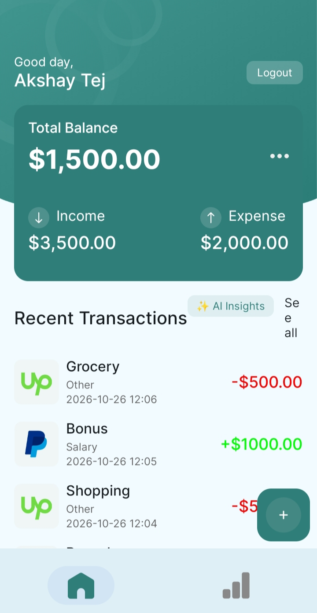
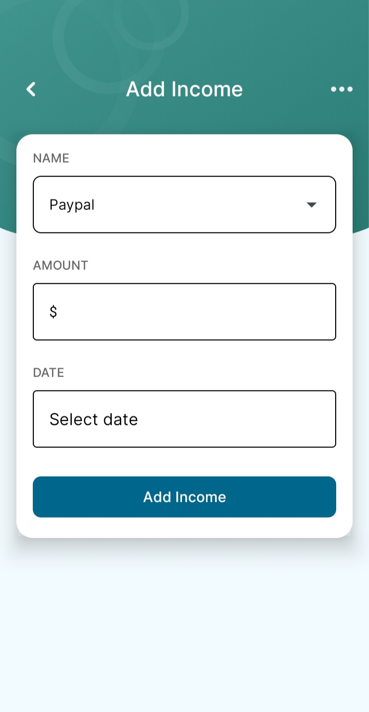
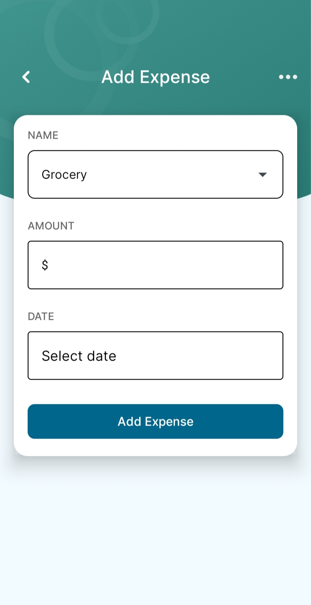
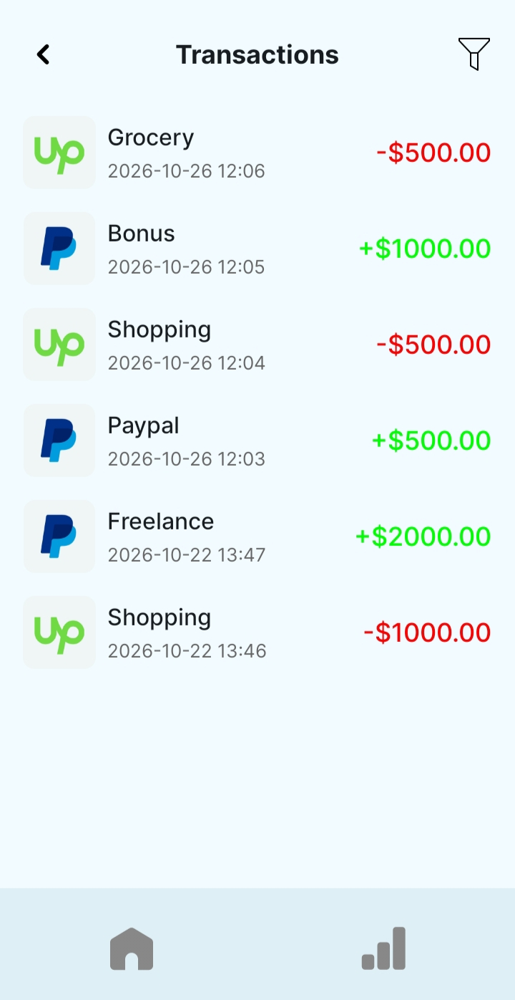
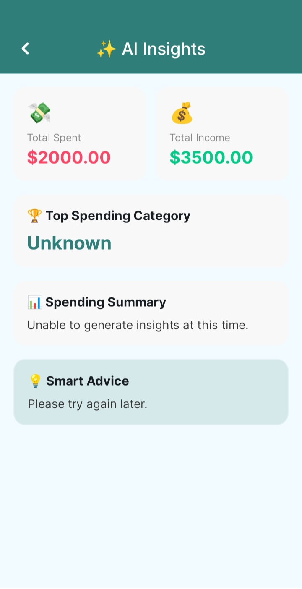
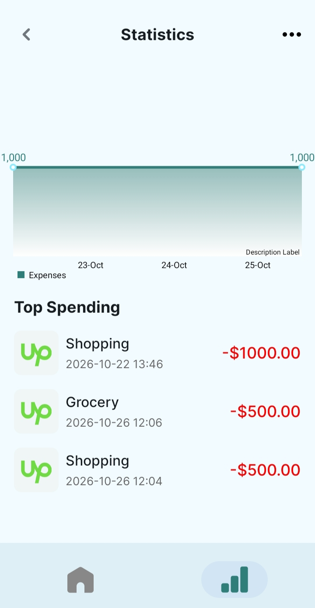

# AI Expense Tracker

An Android expense tracker that **automatically categorizes transactions with AI** and generates **personalized spending insights**. The app is built with Kotlin and Jetpack Compose, backed by a Spring Boot REST API, and uses **Groq LLaMA 3.3 70B** through Spring AI.

---

## Screenshots

## Screenshots

<p align="center">
  
  
  
</p>

<p align="center">
  
  
  
</p>

## Demo Video

[▶️ Watch the Expense Tracker Demo](pics/expense%20tracker.mp4)

## Table of Contents

1. [Features](#features)
2. [Tech Stack](#tech-stack)
3. [Architecture](#architecture)
4. [How It Works](#how-it-works)
5. [Project Structure](#project-structure)
6. [API Reference](#api-reference)
7. [Data Model](#data-model)
8. [Getting Started](#getting-started)
9. [Configuration](#configuration)
10. [Security](#security)
11. [Known Limitations](#known-limitations)
12. [Roadmap](#roadmap)

---

## Features

- **Auth**: register and log in with email and password. Passwords are hashed with BCrypt and sessions use JWT.
- **AI categorization**: leave the category empty and the LLM assigns one of `Food`, `Transport`, `Shopping`, `Health`, `Entertainment`, `Utilities`, `Education`, `Travel` or `Other`.
- **Income and expense tracking**: add, list and delete transactions. Income is automatically labelled `Salary`.
- **AI spending insights**: a short summary of spending patterns, the top spending category and one piece of actionable advice.
- **Dashboard**: total balance, income and expense on the home screen.
- **Stats screen**: a line chart of daily spending and the top 5 expenses.
- **Auto logout**: an expired or invalid token clears the session and returns the user to login.
- **Graceful AI fallback**: if the AI call fails, the category defaults to `Other` and the transaction is still saved.

---

## Tech Stack

| Layer      | Technology                                                                 |
|------------|----------------------------------------------------------------------------|
| Mobile app | Kotlin, Jetpack Compose, Navigation Compose, Hilt, Retrofit, OkHttp, Gson, MPAndroidChart |
| Backend    | Java, Spring Boot, Spring Security, Spring Data JPA, Spring AI, Lombok, JJWT |
| Database   | PostgreSQL                                                                 |
| AI         | Groq API (`llama-3.3-70b-versatile`) through Spring AI's OpenAI-compatible client |
| Hosting    | Render (backend)                                                           |
| Build      | Gradle (Android), Maven (backend)                                          |

---

## Architecture

```
+----------------------------------------------------+
|                 ANDROID APP (Kotlin)               |
|                                                    |
|  Compose Screens <--> Hilt ViewModels              |
|                            |                       |
|          TokenManager <----+----> Retrofit / OkHttp|
|        (JWT in prefs)                    |          |
+------------------------------------------|---------+
                                           | HTTPS + JSON
                                           | Authorization: Bearer <JWT>
                                           v
+----------------------------------------------------+
|             SPRING BOOT API (on Render)            |
|                                                    |
|  JwtAuthFilter --> Controllers --> Services        |
|                                      |      |      |
|                                      |      v      |
|                                      |  ExpenseAiService
|                                      |  (Spring AI ChatClient)
|                                      v      |      |
|                            JPA Repositories |      |
+--------------------------------|------------|------+
                                 |            |
                                 v            v
                          +------------+  +-------------------+
                          | PostgreSQL |  | Groq API          |
                          |            |  | LLaMA 3.3 70B     |
                          +------------+  +-------------------+
```

---

## How It Works

### 1. Authentication

```
App launch
   |
   v
JWT saved on device? --Yes--> /home
   |
   No
   v
/login --> POST /api/auth/login or /register
   |
   v
Backend validates, BCrypt check, signs JWT (HS256, 24h)
   |
   v
App stores token + name + email --> /home
```

### 2. Adding a transaction with AI categorization

```
Add Expense screen (title, amount, notes)
   |
   v
POST /api/expenses   (category = null)
   |
   v
JwtAuthFilter validates Bearer token
   |
   v
Bean validation (title, positive amount, type)
   |
   v
Category blank?
   |-- Type = INCOME  --> "Salary" (no AI call)
   |-- Type = EXPENSE --> prompt Groq LLaMA --> category
   |                       (on failure: "Other")
   v
Save Expense in PostgreSQL --> return ExpenseResponse
```

### 3. AI insights

```
Home --> Insights
   |
   v
GET /api/expenses/insights
   |
   v
No expenses?  --> "No expenses recorded yet"
   |
   v
Totals + expense list --> prompt Groq LLaMA
   |
   v
Parse SUMMARY / TOP_CATEGORY / ADVICE --> InsightResponse
```

---

## Project Structure

```
AI-Expense-Tracker/
├── app/                                   # Android application
│   └── src/main/java/com/example/expensetracker/android/
│       ├── MainActivity.kt
│       ├── NavHostScreen.kt               # Navigation graph + bottom bar
│       ├── base/                          # BaseViewModel, navigation events
│       ├── di/                            # Hilt modules (network, database)
│       ├── network/                       # Retrofit service, API models, TokenManager
│       ├── data/                          # Room database, DAO, entities
│       ├── feature/
│       │   ├── login/                     # Login and register
│       │   ├── home/                      # Dashboard and recent transactions
│       │   ├── add_expense/               # Add expense or income
│       │   ├── transactionlist/           # All transactions
│       │   └── stats/                     # Charts and AI insights
│       ├── ui/theme/                      # Compose theme
│       └── utils/
│
├── backend/AI-Expense-Tracker-Backend-Render-main/
│   └── src/main/java/com/example/expensetracker/
│       ├── controller/                    # AuthController, ExpenseController
│       ├── service/                       # AuthService, ExpenseService, JwtService
│       ├── ai/                            # ExpenseAiService (Groq via Spring AI)
│       ├── auth/                          # JwtAuthFilter
│       ├── config/                        # SecurityConfig, CorsConfig, GlobalExceptionHandler
│       ├── entity/                        # User, Expense
│       ├── repository/                    # UserRepository, ExpenseRepository
│       └── dto/                           # Request and response objects
│
├── build.gradle.kts
├── settings.gradle.kts
└── gradle/
```

---

## API Reference

Base URL: `https://ai-expense-tracker-backend-render.onrender.com`

### Auth (public)

| Method | Endpoint             | Description                      |
|--------|----------------------|----------------------------------|
| POST   | `/api/auth/register` | Create an account, returns JWT   |
| POST   | `/api/auth/login`    | Log in, returns JWT              |

### Auth (requires JWT)

| Method | Endpoint             | Description                           |
|--------|----------------------|---------------------------------------|
| PUT    | `/api/auth/profile`  | Update display name                   |
| PUT    | `/api/auth/budget`   | Update monthly budget                 |
| PUT    | `/api/auth/currency` | Update currency code                  |
| PUT    | `/api/auth/password` | Change password (min 6 characters)    |

### Expenses (requires JWT)

| Method | Endpoint                 | Description                              |
|--------|--------------------------|------------------------------------------|
| POST   | `/api/expenses`          | Add a transaction (AI categorizes if no category) |
| GET    | `/api/expenses`          | List the user's transactions, newest first |
| DELETE | `/api/expenses/{id}`     | Delete one of the user's transactions    |
| GET    | `/api/expenses/insights` | AI-generated spending insights           |

### Example requests

**Register**

```json
POST /api/auth/register
{
  "name": "Akshay",
  "email": "akshay@example.com",
  "password": "secret123"
}
```

**Add an expense**

```json
POST /api/expenses
Authorization: Bearer <token>

{
  "title": "Pizza with friends",
  "amount": 450.0,
  "type": "EXPENSE",
  "notes": "Dinner",
  "category": null
}
```

**Response**

```json
{
  "id": 12,
  "title": "Pizza with friends",
  "amount": 450.0,
  "category": "Food",
  "type": "EXPENSE",
  "notes": "Dinner",
  "transactionDate": "2026-10-26 18:30"
}
```

**Insights response**

```json
{
  "summary": "Most of your spending goes to food and shopping.",
  "topSpendingCategory": "Food",
  "advice": "Set a weekly food budget to reduce eating out.",
  "totalExpenses": 5400.0,
  "totalIncome": 20000.0
}
```

### Error responses

| Status | Meaning                                        |
|--------|------------------------------------------------|
| 400    | Validation error or illegal argument           |
| 403    | Missing, invalid or expired JWT                |
| 500    | Unexpected server error                        |

---

## Data Model

```
+------------------+         +----------------------+
|      users       | 1     * |       expenses       |
+------------------+---------+----------------------+
| id (PK)          |         | id (PK)              |
| email (unique)   |         | title                |
| password (BCrypt)|         | amount               |
| name             |         | category             |
| monthlyBudget    |         | type (EXPENSE/INCOME)|
| currency         |         | notes                |
| createdAt        |         | transactionDate      |
+------------------+         | createdAt            |
                             | user_id (FK)         |
                             +----------------------+
```

Every expense query is scoped to the logged-in user's id, so users can only see and delete their own data.

---

## Getting Started

### Prerequisites

- Android Studio (latest stable) with a recent Android SDK
- JDK 17 or newer
- A PostgreSQL database
- A [Groq API key](https://console.groq.com)

### 1. Clone the repository

```bash
git clone https://github.com/TAkshay-Tej/AI-Expense-Tracker.git
cd AI-Expense-Tracker
```

### 2. Run the backend

```bash
cd backend/AI-Expense-Tracker-Backend-Render-main

export SPRING_DATASOURCE_URL=jdbc:postgresql://localhost:5432/expensedb
export SPRING_DATASOURCE_USERNAME=postgres
export SPRING_DATASOURCE_PASSWORD=your_password
export JWT_SECRET_KEY=your_long_random_secret_at_least_32_chars
export OPENAI_API_KEY=your_groq_api_key
export OPENAI_GROK_URL=https://api.groq.com/openai

./mvnw spring-boot:run
```

The API starts on `http://localhost:8080` (or the `PORT` environment variable).

### 3. Run the Android app

1. Open the project root in Android Studio.
2. In `app/src/main/java/com/example/expensetracker/android/network/NetworkModule.kt`, set `BASE_URL` to your backend:
   - Deployed: your Render URL
   - Local emulator: `http://10.0.2.2:8080/`
3. Let Gradle sync, then run on an emulator or device.

> The free Render tier sleeps when idle, so the first request after a pause can take about a minute.

---

## Configuration

Backend environment variables (read in `application.properties`):

| Variable                     | Purpose                                         |
|------------------------------|-------------------------------------------------|
| `PORT`                       | Server port (default `8080`)                    |
| `SPRING_DATASOURCE_URL`      | PostgreSQL JDBC URL                             |
| `SPRING_DATASOURCE_USERNAME` | Database user                                   |
| `SPRING_DATASOURCE_PASSWORD` | Database password                               |
| `JWT_SECRET_KEY`             | HMAC signing secret for JWT                     |
| `OPENAI_API_KEY`             | Groq API key                                    |
| `OPENAI_GROK_URL`            | OpenAI-compatible base URL for Groq             |

